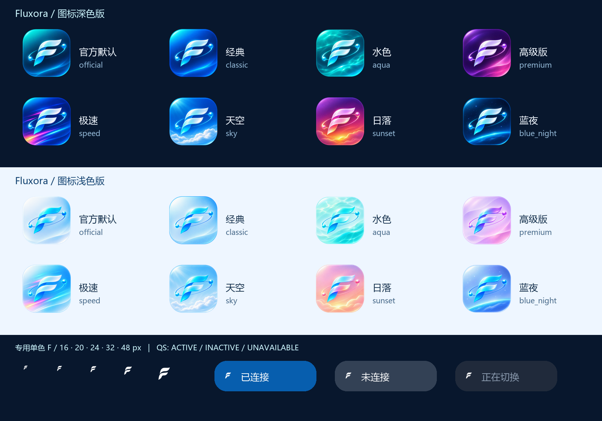

<div align="center">


# Fluxora

An open-source, cross-platform Mihomo routing client.

[Downloads](https://github.com/Tiam9173/fluxora/releases) · [Issues](https://github.com/Tiam9173/fluxora/issues) · [简体中文](README.md) · [GPL-3.0](LICENSE)

[Telegram channel](https://t.me/Fluxora_Channel) · [Telegram group](https://t.me/Fluxora_Group1)
</div>

## Releases and installation

The published stable release is [v1.1.1](https://github.com/Tiam9173/fluxora/releases/tag/v1.1.1). The `dev` branch is preparing **1.1.2-rc.2 pre-release**. A source version does not mean packages have been published. See the [rc2 notes](RELEASE_NOTES_1.1.2-rc.2.md) for changes and limitations; download only the actual attachments on [Releases](https://github.com/Tiam9173/fluxora/releases).

| Platform | Packages | Architectures |
| --- | --- | --- |
| Android 8.0+ | APK | arm64-v8a / armeabi-v7a / x86_64 / universal |
| Windows 10 / 11 | Installer, portable ZIP | amd64 / amd64-compatible / arm64 |
| macOS | DMG | Apple Silicon / Intel / Intel-compatible |
| Linux | AppImage, DEB, RPM | amd64 / amd64-compatible; ARM64 DEB |
| iOS | No official client | — |

These formats exist in v1.1.1; this is not a claim that every candidate already has all packages. Prefer regular builds; use `compatible` variants for older CPUs or systems. Regular macOS builds target 12+; check individual release notes for compatible builds.

On Windows, run the installer or extract the portable ZIP and open `Fluxora.exe`. Install the matching APK on Android, open the DMG on macOS, or use the appropriate Linux package. Current Windows builds use a self-signed certificate, which may still trigger Windows trust or SmartScreen prompts. See the [signing policy](SIGNING-POLICY.md).

## Features

- **Routing**: rule / global / direct modes, proxy selection, latency tests, connection and traffic records; system proxy, TUN, tray and shortcuts where supported.
- **Configuration**: local files, subscriptions, profile switching, subscription aggregation, rule providers and JavaScript configuration processing.
- **Chain proxy**: front and exit nodes, two / three-hop configurations and explicit multiple front hops, topology and diagnostics. Candidate pools and manual actions are not automatic failover; chain auto Failover is currently absent.
- **Cloudflare WARP**: account registration, WARP+ key settings, endpoints, MTU, UDP and upstream dialers. Availability depends on your nodes, network and Cloudflare.
- **Network tools**: exit IPv4/IPv6, network and media checks, optional IP reputation, logs and requests. A probe timeout does not establish that a node is unusable. A reputation score is not a security or anonymity guarantee.

## The 1.1.2 candidate interface

The existing Flutter application and state management now support Classic, Hybrid Glass and reduced-effects materials, light / dark / system appearance, custom accent colours and Android dynamic colour. The desktop sidebar switches between 208px labelled navigation and a 68px icon rail. Mobile uses compact floating navigation. Dashboard widgets can be added, reordered and removed while preserving the primary connection control.

Motion follows actual state and the system reduced-motion preference. Dense lists retain solid surfaces. These implementations are not a claim of performance certification on every device.


### Brand icons

Eight styles each have separate dark and light icon artwork: Official, Classic, Aqua, Premium, Speed, Sky, Sunset and Blue Night. Open Settings → Theme → App icons. Icon colours are independent of the page theme.



Android implements switching between packaged launcher aliases; launcher refresh, notifications and Quick Settings still need device acceptance. Desktop saves the in-app mark; installed system icons change at build time, with no runtime switching in this implementation. Notifications, tray and Android Quick Settings use dedicated monochrome F marks. iOS Control Centre and downloading arbitrary icon packs at runtime are not implemented. See the [icon sources and generation steps](design/brand_icons/README.txt).

## Usage and privacy

Import your own subscription or local configuration, select a profile and a node, then connect. Fluxora does not supply proxy servers or subscriptions. TUN and system proxy availability depends on the platform and permissions; system proxy affects applications that honour that setting.

Subscription updates, latency tests, exit-IP / media checks and WARP registration contact their respective services. IP reputation is off by default; enabling and querying it sends the queried IP to the intelligence provider. Having no Fluxora cloud account does not mean there are no third-party requests. Remove subscription URLs, keys and personal information before sharing configurations, logs or diagnostics.

## Development and verification

Install Flutter / Dart and the target platform toolchain. Core and Helper builds also require Go / Rust. CI currently pins Flutter 3.47.4, with workflow-specific versions on some ARM runners. See [.github/workflows](.github/workflows).

```sh
git clone https://github.com/Tiam9173/fluxora.git
cd fluxora
flutter pub get
dart run build_runner build -d
flutter analyze
flutter test
```

A local source run is not an official signed package. Windows distribution builds also verify Core / Helper asset anchors. Candidate checks and outstanding validation are recorded in [rc2 readiness](RELEASE_READINESS_1.1.2-rc.2.md).

## Contributing

Report the platform, version, reproduction steps and redacted logs through [Issues](https://github.com/Tiam9173/fluxora/issues), or contribute through [Pull Requests](https://github.com/Tiam9173/fluxora/pulls). Preserve GPL and third-party notices.

Other languages: [日本語](readme/README_ja.md) · [한국어](readme/README_ko.md) · [Русский](readme/README_ru.md) · [فارسی](readme/README_fa.md). Translations may lag; use this page and the Chinese homepage for current release status.

## License & Lineage


Fluxora is distributed under the GNU General Public License v3.0. See [LICENSE](LICENSE).

Fluxora includes and interoperates with open-source components, including the [Mihomo](https://github.com/MetaCubeX/mihomo) core and other Flutter, Go, Rust, and platform libraries. Their applicable copyright notices and licenses remain in their respective source directories and distribution metadata. See [NOTICE](NOTICE) and the relevant component license files.

Fluxora is an independent continuation of the [Bettbox](https://github.com/appshubcc/Bettbox) project. Project lineage: **FlClash → Bettbox → Fluxora**. Fluxora's branding, UI, design system and Windows components were developed independently on that base, starting 2026-09-25. See [NOTICE](NOTICE) for the full attribution record.

Fluxora is an independent product identity. This repository does not present itself as an official product of any upstream project.
