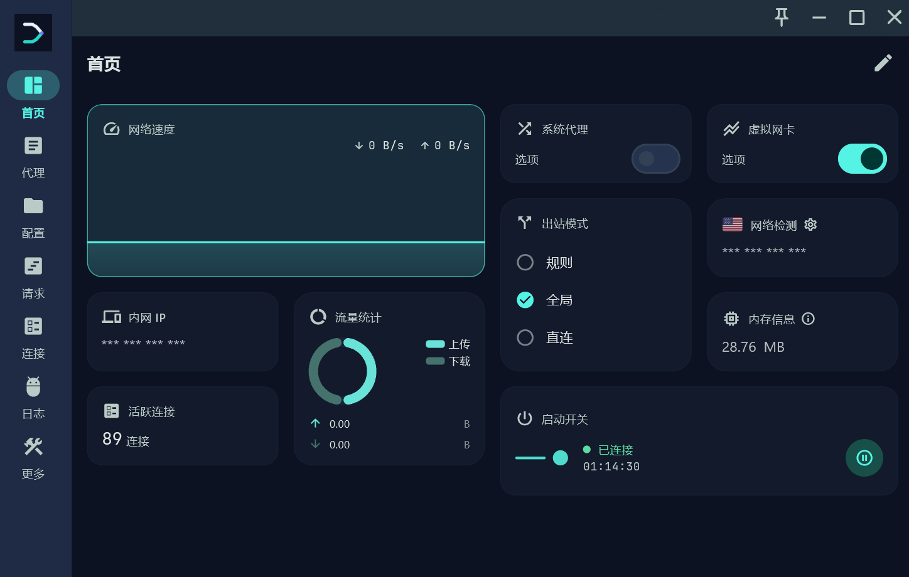

<div align="center">


# Fluxora 流序

**Make routing legible. — مسیریابی روشن، کنترلی آرام.**

کلاینت متن‌باز و چندسکویی مسیریابی شبکه بر پایهٔ Mihomo.
پروفایل‌ها، اتصال‌ها، قوانین و وضعیت ترافیک — در یک رابط کاربری سنجیده، روشن و قابل بازبینی.

[](../LICENSE)
[](#پلتفرمهای-پشتیبانیشده)
[](https://github.com/Tiam9173/fluxora/stargazers)

<!-- زبان مستندات / Documentation language -->

[](../README.md)
[](../README_en.md)
[](README_ja.md)
[](README_ko.md)
[](README_ru.md)
[](README_fa.md)

**[دانلود](#دانلود)** · **[گزارش مشکل](https://github.com/Tiam9173/fluxora/issues)** · **[مشارکت](#مشارکت)** · **[مجوز](../LICENSE)**

📢 **[کانال رسمی Telegram](https://t.me/Fluxora_Chanel)** · 💬 **[گروه رسمی Telegram](https://t.me/Fluxora_Grup)**

</div>

---

## انجمن رسمی

- 📢 **[کانال رسمی Telegram](https://t.me/Fluxora_Chanel)** —— به‌روزرسانی‌های Fluxora، خبرهای انتشار نسخه و رویدادهای پروژه
- 💬 **[گروه رسمی Telegram](https://t.me/Fluxora_Grup)** —— گفت‌وگوی جمعی، گزارش مشکل و تبادل تجربهٔ استفاده

## چرا Fluxora

بیشتر کلاینت‌های پروکسی «وصل شدن» را پایان کار می‌دانند و قوانین، گزارش‌ها و وضعیت اتصال‌ها را در لایه‌های تودرتوی زیرمنو انبار می‌کنند. Fluxora برعکس عمل می‌کند: **نخست وضعیت را دیدنی می‌کند، سپس دسترسی به عملیات را ممکن.**

بر پایهٔ هستهٔ Mihomo (Clash Meta) و ساخته‌شده با Flutter، روی دسکتاپ و موبایل یک ساختار اطلاعاتی یکسان ارائه می‌دهد——داشبورد، پروکسی، پروفایل‌ها، ابزارها، گزارش‌ها، درخواست‌ها، منابع، اسکریپت‌ها و اتصال‌ها؛ نُه صفحه که هرکدام نقش خود را دارند، بدون انبوه‌سازی و بدون پنهان‌کاری.

طراحی از سه اصل پیروی می‌کند: **سنجیدگی** (بدون انیمیشن‌های تزئینی و جلوه‌های نئونی)، **روشنی** (وضعیت همیشه از عملیات چشمگیرتر است)، **قابل بازبینی** (متن‌باز، بدون سامانهٔ حساب کاربری، بدون وابستگی بستهٔ اعلام‌نشده).

Fluxora یک محصول مستقل است و هیچ رابطهٔ رسمی با هیچ پروژهٔ بالادستی ندارد. خاستگاه و تعهدات مجوز آن به‌طور کامل در [NOTICE](../NOTICE) ثبت شده است.

## مزیت‌های کلیدی

- **رابط کاربری مدرن** — سامانهٔ طراحی Material 3 و نشانه‌های طراحی یکپارچه (رنگ / اندازهٔ قلم / فاصله‌ها / گردی گوشه‌ها / حرکت). این یک بازنویسی سطحی از رابط بالادستی نیست.
- **یکدستی میان سکوها** — Windows، macOS، Linux و Android همان کد Flutter و همان ساختار اطلاعاتی را به اشتراک می‌گذارند.
- **کنترل کامل پروکسی** — سه حالت خروج: قانون / سراسری / مستقیم؛ انتخاب گروه پروکسی، سنجش تأخیر، پروکسی زنجیره‌ای با رلهٔ پیشین و رلهٔ خروجی.
- **تصاحب شبکه** — کارت شبکهٔ مجازی TUN و پروکسی سیستم؛ اقامت دائمی در سینی سیستم و میان‌برهای سراسری روی دسکتاپ.
- **سامانهٔ پوسته** — روشن / تیره / هم‌راه با سیستم، حالت سیاه مطلق، ۷ مجموعه رنگ برند؛ در Android پشتیبانی از رنگ‌های پویا Material You.
- **متن‌باز و قابل بازبینی** — GPL-3.0. هسته، موتور اسکریپت و وابستگی‌ها همه قابل بررسی‌اند و هیچ سامانهٔ حساب ابری وجود ندارد.

## قابلیت‌ها

### اتصال
- پروکسی سیستم (دسکتاپ)
- کارت شبکهٔ مجازی TUN (همراه با انتخاب نوع پشته و حالت مسیریابی)
- حالت‌های خروج: قانون / سراسری / مستقیم
- فهرست اتصال‌ها با ترافیک زنده و بستن اتصال
- راه‌اندازی و توقف هوشمند: با اتصال به شبکهٔ مشخص، سرویس پروکسی خودکار متوقف می‌شود

### نودها
- گروه‌های پروکسی: انتخاب / سنجش خودکار سرعت / انتقال در خطا / توازن بار
- سنجش تأخیر و جابه‌جایی میان نودها
- پروکسی زنجیره‌ای (رلهٔ پیشین / رلهٔ خروجی)

### پیکربندی
- مدیریت چند پروفایل (فایل محلی / پیوند اشتراک)
- درون‌ریزی و به‌روزرسانی پروفایل، منابع قوانین (rule providers)

### ابزارها
- بررسی شبکه، آی‌پی داخلی، بررسی رفع محدودیت رسانه
- بازنویسی DNS، بازنویسی Sniffer، بازنویسی NTP
- کلید IPv6، مصرف حافظه، آمار ترافیک
- گزارش‌ها، ثبت درخواست‌ها، عیب‌یابی اتصال
- اسکریپت‌های JavaScript (پردازش قوانین و پیکربندی)

### شخصی‌سازی
- روشن / تیره / هم‌راه با سیستم
- حالت سیاه مطلق (OLED)
- ۷ مجموعه رنگ برند + رنگ اصلی دلخواه
- رنگ‌های پویا Material You در Android
- سینی سیستم، میان‌برهای سراسری و اجرای خودکار در دسکتاپ

## رابط کاربری



## پلتفرمهای پشتیبانیشده

| پلتفرم | وضعیت |
|---|---|
| Windows 10 / 11 | پشتیبانی می‌شود |
| macOS 12+ | پشتیبانی می‌شود |
| Linux | پشتیبانی می‌شود |
| Android 8.0+ | پشتیبانی می‌شود |
| iOS | کلاینت رسمی ندارد |

## دانلود

نسخهٔ پایدار به‌زودی منتشر می‌شود. پس از انتشار، بسته‌های نصب یک‌جا در **[GitHub Releases](https://github.com/Tiam9173/fluxora/releases)** قرار می‌گیرند و نام‌گذاری آن‌ها به شکل `Fluxora-<version>-<platform>` خواهد بود.

در حال حاضر این مخزن **هنوز هیچ انتشار رسمی ندارد**؛ بنابراین در پایین پیوند قابل کلیکی برای بستهٔ نصب وجود ندارد——پس از انتشار به صفحهٔ Releases بازگردید.

## نصب

### Windows
1. بستهٔ همراه (portable) ویندوز را از Releases دانلود کنید (`*-windows-amd64-portable.zip`).
2. آن را در هر پوشه‌ای باز کنید (نیازی به نصب نیست).
3. فایل `Fluxora.exe` را اجرا کنید.

> برنامهٔ نصب (جادوگر `.exe`) هنوز در حال آماده‌سازی است؛ در حال حاضر از بستهٔ همراه استفاده کنید.

### Android
فایل APK متناسب با معماری دستگاه را از Releases دانلود و به‌صورت دستی نصب کنید، یا منتظر نسخهٔ فروشگاه برنامه بمانید.

### Linux
فایل AppImage / deb / rpm را از Releases دانلود کنید (بسته به محتوای انتشار).

### macOS
فایل DMG متناسب با معماری دستگاه را از Releases دانلود کنید.

> بسته‌های نصب رسمی Linux و macOS هنوز ساخته نشده‌اند؛ محتوای واقعی صفحهٔ Releases را مبنا بگیرید.

## پرسش‌های متداول

### Fluxora چیست؟
یک کلاینت متن‌باز و چندسکویی مسیریابی شبکه بر پایهٔ هستهٔ Mihomo (Clash Meta) که با Flutter ساخته شده است.

### از چه پلتفرم‌هایی پشتیبانی می‌کند؟
Windows، macOS، Linux و Android. برای iOS در حال حاضر کلاینت رسمی وجود ندارد و در برنامه‌های کنونی هم گنجانده نشده است.

### رابطهٔ Fluxora با پروژه‌های بالادستی چیست؟
Fluxora یک **محصول مستقل** است و انتشار رسمی هیچ پروژهٔ بالادستی نیست. این پروژه ادامهٔ مستقل Bettbox است و برند، رابط کاربری، سامانهٔ طراحی و اجزای ویندوز بر همان پایه و به‌صورت مستقل توسعه یافته‌اند. خاستگاه کامل و تعهدات مجوز در [NOTICE](../NOTICE) آمده است.

### متن‌باز است؟ با چه مجوزی؟
متن‌باز است و از **GPL-3.0** استفاده می‌کند. متن کامل در [LICENSE](../LICENSE) آمده است.

### چگونه پیکربندی را درون‌ریزی کنم؟
در صفحهٔ «پروفایل‌ها» پیوند اشتراک را بیفزایید یا فایل پیکربندی محلی را درون‌ریزی کنید و پس از انتخاب، اتصال برقرار می‌شود. درون‌ریزی مستقیم با پیوند `fluxora://install-config` نیز پشتیبانی می‌شود.

### تفاوت TUN و پروکسی سیستم چیست؟
پروکسی سیستم تنها بر برنامه‌هایی اثر می‌گذارد که تنظیمات پروکسی سیستم را رعایت می‌کنند. TUN از طریق کارت شبکهٔ مجازی ترافیک را در لایه‌ای پایین‌تر تصاحب می‌کند، بنابراین گسترهٔ بیشتری دارد و معمولاً به دسترسی مدیر نیاز دارد. در دسکتاپ هر دو را می‌توان جداگانه خاموش و روشن کرد.

### چرا برای برخی پلتفرم‌ها بستهٔ نصب وجود ندارد؟
هر بستهٔ انتشار به محیط ساخت خود نیاز دارد (Linux به زنجیرهٔ ابزار GTK و macOS به امضا و تأیید Xcode). این‌ها همراه نخستین انتشار پایدار به‌تدریج تکمیل می‌شوند.

### آیا داده‌های من گردآوری می‌شود؟
نه. Fluxora سرویس حساب ابری ارائه نمی‌دهد و ارسال آمار هم در آن تعبیه نشده است. اشتراک‌ها، قوانین و درخواست‌های شبکه تنها بر پایهٔ پیکربندی‌ای که خودتان انتخاب می‌کنید تعیین می‌شوند.

## توسعه

**پیش‌نیازها**: Flutter (همراه با Dart)، Android SDK/NDK و JDK، و ابزارهای ساخت سکوی هدف (در ویندوز Visual Studio Build Tools، در macOS Xcode و در Linux کتابخانه‌های توسعهٔ GTK). هستهٔ پروکسی و Helper اجزایی به Go / Rust هستند و به زنجیرهٔ ابزار مربوط خود نیاز دارند.

```bash
git clone https://github.com/Tiam9173/fluxora.git
cd fluxora
flutter pub get
dart run build_runner build -d
flutter run            # یا flutter build windows --release
```

## مشارکت

از ثبت Issue، بهبود مستندات، رفع اشکال و مشارکت در کد استقبال می‌کنیم:

- **گزارش اشکال / پیشنهاد قابلیت** → [Issues](https://github.com/Tiam9173/fluxora/issues)
- **مشارکت در کد** → [Pull Requests](https://github.com/Tiam9173/fluxora/pulls)

پیش از ارسال تغییرات مطمئن شوید که وابستگی بستهٔ اعلام‌نشده‌ای اضافه نمی‌کنید و اعلان‌های مجوز GPL یا اشخاص ثالث را حذف نمی‌کنید.

## مجوز و تبار پروژه

Fluxora is distributed under the GNU General Public License v3.0. See [LICENSE](../LICENSE).

Fluxora includes and interoperates with open-source components, including the [Mihomo](https://github.com/MetaCubeX/mihomo) core and other Flutter, Go, Rust, and platform libraries. Their applicable copyright notices and licenses remain in their respective source directories and distribution metadata. See [NOTICE](../NOTICE) and the relevant component license files.

Fluxora is an independent continuation of the [Bettbox](https://github.com/appshubcc/Bettbox) project. Project lineage: **FlClash → Bettbox → Fluxora**. Fluxora's branding, UI, design system and Windows components were developed independently on that base, starting 2026-09-25. See [NOTICE](../NOTICE) for the full attribution record.

Fluxora is an independent product identity. This repository does not present itself as an official product of any upstream project.
